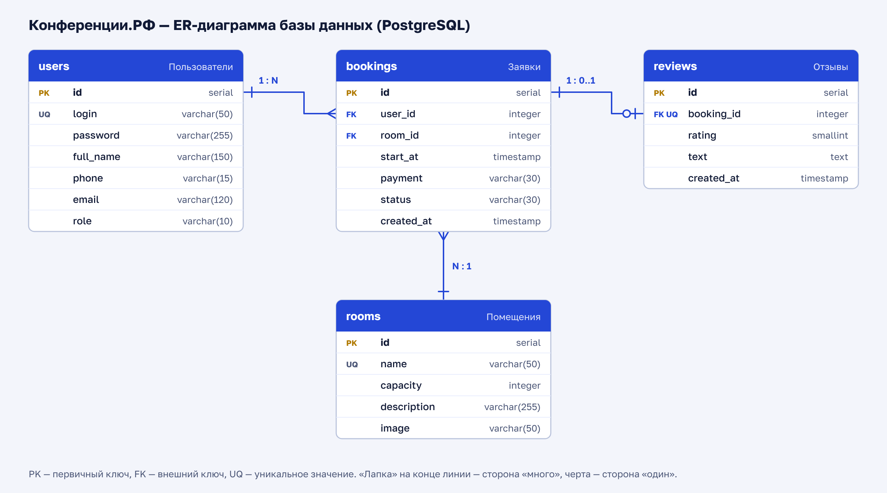

# Конференции.РФ

Портал бронирования помещений для конференций: аудитория, коворкинг, кинозал.
Сделан по заданию демонстрационного экзамена КИМ 09.02.07-3-2027.

**Технологии:** Node.js + Express, PostgreSQL, HTML, CSS, JavaScript и библиотека Bootstrap.
Страницы запрашивают данные у сервера через `fetch`, сервер отвечает в формате JSON.

## Запуск

Нужны Node.js (18 или новее) и PostgreSQL.

1. Создайте базу данных: в pgAdmin добавьте базу с именем `konferencii_rf`,
   откройте для неё Query Tool, загрузите файл `db/schema.sql` и выполните его.
2. В файле `models.js` впишите свой пароль от PostgreSQL (строка `password`).
3. В папке проекта выполните команды:

   ```
   npm install
   npm start
   ```

4. Откройте http://localhost:3000

Администратор: логин `Conf2027`, пароль `Demo77` (вход через обычную страницу входа).
Он добавляется в базу файлом `db/schema.sql`.

## Файлы проекта

| Файл | Что в нём |
| --- | --- |
| `server.js` | сервер: проверка данных, вход, заявки, отзывы, панель администратора |
| `models.js` | подключение к базе и классы `User`, `Room`, `Booking`, `Review` |
| `db/schema.sql` | таблицы базы данных, помещения и администратор |
| `db/er-diagram.pdf` | ER-диаграмма (есть и картинка `er-diagram.png`) |
| `public/register.html` | регистрация |
| `public/login.html` | вход |
| `public/bookings.html` | мои заявки и отзывы |
| `public/booking-new.html` | новая заявка |
| `public/admin.html` | панель администратора |
| `public/script.js` | общие функции страниц: запрос к серверу, показ ошибок |
| `public/style.css` | дополнительные стили и анимации |
| `public/lib` | библиотека Bootstrap и иконки Bootstrap Icons (лежат в проекте, интернет не нужен) |
| `public/img` | картинки помещений |

## База данных



Четыре таблицы: `users` (пользователи и администратор), `rooms` (помещения),
`bookings` (заявки), `reviews` (отзывы).

## Что сделано по заданию

**Задание 1**

- Регистрация с проверкой полей: логин (латиница и цифры, от 6 символов, уникальный), пароль (от 8 символов),
  ФИО (кириллица и пробелы), телефон `8(XXX)XXX-XX-XX`, почта.
- Вход с сообщением о неверном логине или пароле. Ссылки «Еще не зарегистрированы? Регистрация» и обратно.
- Просмотр своих заявок и отзыв о мероприятии.
- Новая заявка: помещение, дата начала, способ оплаты, кнопка «Отправить».
- Панель администратора: вход `Conf2027` / `Demo77`, все заявки, смена статуса
  «Новая» → «Мероприятие назначено» или «Завершено».
- База данных PostgreSQL, ER-диаграмма, классы (ООП) в `models.js`, фреймворк Express.

**Задание 2**

- Оформление всех страниц на библиотеке Bootstrap, картинки помещений и иконки Bootstrap Icons.
- Вёрстка для смартфона 390×844.
- Ошибки валидации показываются на форме под полями.
- Отзыв можно оставить только после статуса «Завершено».
- Помещение и способ оплаты выбираются из выпадающих списков.
- В панели администратора заявки показаны карточками, есть фильтр по статусу и помещению.

**Задание 3**

- База доработана: таблица отзывов, внешние ключи, ограничения `CHECK` и `UNIQUE`, индексы.
- Адаптивная вёрстка (сетка Bootstrap): на телефоне всё в одну колонку, на широком экране карточки в несколько колонок.
- Анимации: плавное появление страницы, «встряхивание» поля с ошибкой, подъём карточки и нажатие кнопки.

## Замечания

- Архива с изображениями из задания не было, картинки помещений нарисованы самостоятельно.
- В задании 1 кнопка регистрации называется «Создать пользователя», в задании 2 — «Зарегистрироваться».
  Использовано второе название, оно меняется в `public/register.html`.
- Пароли хранятся в базе в виде хеша (библиотека bcryptjs).
